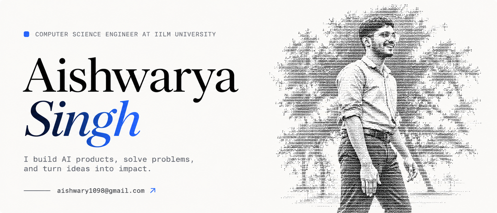

  

# Hi, I'm Aishwarya Singh! 👋

### Computer Science Undergraduate | Software Developer | AI/ML Enthusiast

  
  
  
  

## 👩‍💻 About Me

I'm a Computer Science Engineering undergraduate at **IILM University, Greater Noida**, passionate about software development, artificial intelligence, and building technology-driven solutions to real-world problems.

I enjoy exploring new technologies, developing full-stack applications, experimenting with machine learning, and strengthening my problem-solving skills.

- 🎓 B.Tech Computer Science Engineering (2024–2028).
- 📊 Current CGPA: **8.9/10**.
- 💻 Practicing Data Structures & Algorithms using Java.
- 🤖 Exploring Artificial Intelligence and Machine Learning.
- 🌐 Building full-stack applications using React, Node.js and FastAPI.
- 🔐 Interested in Blockchain, Cybersecurity and Distributed Systems.
- 🚀 Passionate about continuous learning and collaborative development.

**My Goal:** To grow as a software engineer and build scalable, intelligent, and impactful applications.

---

## 🛠️ Technical Skills

### Programming Languages

### Web Development & Backend

### Databases & Developer Tools

### AI / ML & Data Science

- **Libraries:** Pandas, NumPy, Scikit-learn, OpenCV
- **Concepts:** Machine Learning, Data Preprocessing, Recommendation Systems
- **Backend:** Python, FastAPI

### Core Computer Science

`Data Structures & Algorithms` `OOP` `DBMS` `Operating Systems` `Computer Networks` `Cryptography Basics`

---

## 🚀 Featured Projects

<table>
<tr>
<td width="50%" valign="top">

### 🏥 Digital Health Twin

**Personalized Disease Monitoring**

A personalized health monitoring framework designed to create participant-level health profiles and support data-driven health risk analysis.

**Tech Stack**

`Python` `FastAPI` `React` `Pandas` `NHANES`

- Integrated 7 NHANES datasets.
- Created a unified dataset containing 11,933 participants and 73 variables.
- Performed missing-value analysis and feature auditing.
- Designed a modular preprocessing and health analysis pipeline.

</td>
<td width="50%" valign="top">

### 🔐 Blockchain Secure File Sharing

**Decentralized File Sharing System**

A blockchain-based architecture designed to provide secure file sharing with confidentiality, integrity, and access control.

**Tech Stack**

`Solidity` `Ethereum` `IPFS` `Node.js` `React`

- AES-256-CBC file encryption.
- RSA-2048 OAEP key wrapping.
- SHA-256 Merkle-root verification.
- Smart contracts for access management and audit logging.
- Decentralized file storage using IPFS.

</td>
</tr>

<tr>
<td width="50%" valign="top">

### 🛡️ SentinelMesh AI

**AI Security & Policy Enforcement**

A security-focused prototype combining policy-based authorization, API gateway enforcement, and tamper-evident audit logging.

**Tech Stack**

`Python` `FastAPI` `OPA` `Docker` `Nginx`

- FastAPI-based security gateway.
- Open Policy Agent (OPA) policy enforcement.
- Hash-chained audit ledger.
- Protected operations with allow/deny authorization.
- Containerized deployment using Docker.

</td>
<td width="50%" valign="top">

### 🎬 Netflix AI Recommender

**Movie & TV Show Recommendation System**

A content-based recommendation application that suggests movies and TV shows based on similarity.

**Tech Stack**

`Python` `Streamlit` `Pandas` `Scikit-learn` `TMDB API`

- Dataset containing 8,800+ titles.
- Content-based recommendation approach.
- Cosine similarity for recommendation generation.
- TMDB integration for movie posters.
- Interactive Streamlit interface.

</td>
</tr>
</table>

---

## 🌐 Personal Portfolio

### Explore My Work & Development Journey

A personal portfolio showcasing my technical skills, projects, achievements, and development journey.

---

## 📊 GitHub Statistics

 

 

---

## 🧠 Problem Solving

I regularly practice Data Structures and Algorithms to improve my programming fundamentals and analytical thinking.

- 80+ DSA problems solved using Java (as listed in my resume).
- Practicing on LeetCode and GeeksforGeeks.
- Focus areas: Arrays, Strings, Linked Lists, Stacks, Queues, Trees and Recursion.

---

## 🎓 Education

**IILM University, Greater Noida**

Bachelor of Technology – Computer Science Engineering

2024 – 2028

<badge>8.9 / 10 CGPA</badge>

**Relevant Coursework**

- Data Structures & Algorithms
- Object-Oriented Programming
- Database Management Systems
- Operating Systems
- Cloud Computing

---

## 📜 Certifications & Achievements

- ☁️ NPTEL – Cloud Computing Certification.
- 🤖 Google AI-ML Virtual Internship – AICTE–EduSkills Program.
- ☁️ AWS Generative AI Learning Badge.
- 🌐 Infosys Springboard – Internet of Things.
- 💻 Participation in technical competitions and hackathons.
- 🏆 Continuous practice on coding and problem-solving platforms.

---

## 🎯 Currently Learning & Exploring

- Artificial Intelligence and Machine Learning.
- Full-Stack Web Development.
- Backend Engineering with FastAPI.
- Cloud Computing and DevOps.
- Advanced Data Structures and Algorithms.
- Secure and Scalable Software Architecture.

---

## 🤝 Let's Connect!

I'm always open to connecting with developers, collaborating on interesting projects, learning new technologies, and exploring software engineering opportunities.

  

### "Learn continuously. Build fearlessly. Create impact." 🚀

